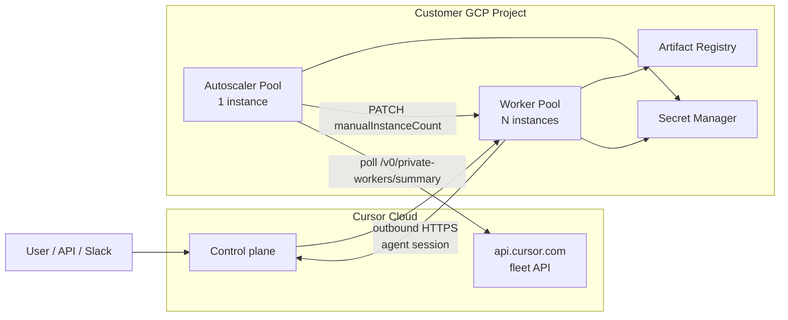

# feat: Self-hosted Cloud Agent pools on Cloud Run (Terraform)

## Summary

Add a new `self-hosted-pools/` directory that deploys Cursor Cloud Agent **self-hosted worker pools** on **Google Cloud Run Worker Pools**, managed entirely with **Terraform** (no shell-based deploy scripts as the source of truth). The stack mirrors Cursor’s documented two-pool design: a **worker pool** running `agent worker start --pool` and a **single-instance autoscaler pool** that polls Cursor’s fleet API and resizes the worker pool via the Cloud Run Admin API.

This document is the implementation plan. **Status: implemented** — see `self-hosted-pools/` for Terraform modules, containers, and environment roots.

---

## Problem frame

Teams on Cursor Enterprise/Team with self-hosted Cloud Agents enabled need workers inside their own GCP project so agent tool execution (git, builds, internal APIs) stays on company infrastructure while inference remains on Cursor’s cloud.

The official Cloud Run guide uses `gcloud` and a Node.js autoscaler deployed from source. This repo will instead provide a **repeatable, reviewable, environment-parameterized** Terraform layout suitable for dev/staging/prod and CI-driven applies.

---

## Requirements

| ID | Requirement |
|----|-------------|
| R1 | New top-level directory `self-hosted-pools/` for all self-hosted pool infrastructure |
| R2 | **Terraform** is the sole deployment mechanism for GCP resources (no bash deploy scripts as primary interface) |
| R3 | Deploy **two** Cloud Run worker pools per environment: Cursor workers + autoscaler |
| R4 | Worker pool runs Cursor `agent` CLI with `--pool`, one **git repo per pool** (`REPO_URL`) |
| R5 | Secrets (`CURSOR_API_KEY`, `GIT_TOKEN`) stored in **Secret Manager**; never in Terraform state as plaintext |
| R6 | Autoscaler polls `GET https://api.cursor.com/v0/private-workers/summary` and updates worker pool `manualInstanceCount` |
| R7 | Support **dev / staging / prod** via separate Terraform environment roots |
| R8 | Document operator runbook (bootstrap secrets, verify workers, rotate keys) in `self-hosted-pools/README.md` |
| R9 | Human architecture plan lives in `docs/plans/` (this file) |

### Success criteria

- After `terraform apply` in dev (with secrets bootstrapped), workers appear in Cursor dashboard **Self-hosted** and `GET /v0/private-workers/summary` shows `connected ≥ MIN_INSTANCES`.
- A Cloud Agent run with self-hosted routing executes on the pool (UI or API with `usePrivateWorker` / pool env).
- Autoscaler adjusts instance count within `[MIN_INSTANCES, MAX_INSTANCES]` under load without `terraform apply` fighting live scale (explicit ownership contract).
- `terraform plan` in prod shows no unexpected secret values; state contains resource IDs only.

---

## Scope boundaries

### In scope

- Terraform modules for: API enablement, IAM, Artifact Registry, Secret Manager **scaffolding**, worker pool, autoscaler pool, optional Direct VPC egress
- Container build **documentation** and CI hooks (image build/push may use Cloud Build in CI; not shell deploy scripts for Run resources)
- Environment-specific `terraform.tfvars` examples (sanitized)
- Verification checklist and operational runbook

### Deferred to follow-up work

- Multi-repo `for_each` worker pools (second pool for another `REPO_URL`) — design supports it; first slice is **one repo / one pool**
- CREMA / KEDA alternative to Cursor’s Node autoscaler
- Prometheus scraping from `/metrics` (document pattern; no GCP Managed Prometheus in v1)
- GitHub Actions `terraform plan/apply` workflow (add after modules stabilize)
- Kubernetes operator path ([self-hosted-k8s](https://cursor.com/docs/cloud-agent/self-hosted-k8s))

### Non-goals

- Replacing Cursor cloud inference (always remains on Cursor)
- Air-gapped / on-prem LLM
- Shell scripts as the canonical deploy path (`gcloud run worker-pools deploy` wrappers)

---

## High-level technical design

### Architecture



### Two-pool model (from Cursor docs)

| Pool | Instances | Image | Purpose |
|------|-----------|-------|---------|
| `cursor-agents-pool` (name configurable) | `manual_instance_count` (autoscaler-managed) | Custom worker image | Clone repo, run `agent worker start --pool` |
| `cursor-autoscaler-pool` | **1** (fixed) | Autoscaler image | Poll fleet summary, resize worker pool |

### Terraform vs autoscaler ownership (decision)

**Decision:** After initial create, **autoscaler owns live `manual_instance_count`**. Terraform manages image, env, secrets wiring, min/max autoscaler env vars, and IAM. Use `lifecycle { ignore_changes = ... }` on worker pool scaling count (exact attribute path validated against `hashicorp/google` provider docs at implementation time).

**Rationale:** Avoids production incidents where `terraform apply` resets capacity during traffic ([flow analysis: TF/autoscaler drift](docs/plans/2026-06-03-001-feat-self-hosted-cloud-run-pools-plan.md)).

### Networking (default)

- **Default:** No VPC — workers use public egress to Cursor (`api2.cursor.sh`), `api.cursor.com` (autoscaler), git host, registries, optional S3 artifacts host.
- **Optional module:** Direct VPC egress (`PRIVATE_RANGES_ONLY` or `ALL_TRAFFIC`) for internal package registries; requires firewall + Private Google Access design.

### Prerequisites (operator / Cursor)

| Prerequisite | Notes |
|--------------|-------|
| Cursor Team/Enterprise with self-hosted enabled | Confirm contract tier; docs vary Team vs Enterprise |
| Dashboard: Allow Self-Hosted Agents | Team admin |
| Service account API key | Required for workers **and** fleet API; not user API keys |
| GCP project + billing | Per environment |
| Git token | RW on target repo for clone/PR flows |

**Verify before implementation:** [Self-Hosted Cloud Run](https://cursor.com/docs/cloud-agent/self-hosted-cloud-run), [Self-Hosted Pool](https://cursor.com/docs/cloud-agent/self-hosted-pool), [Cloud Agents API](https://cursor.com/docs/cloud-agent/api/endpoints).

---

## Output structure (planned)

```
self-hosted-pools/
├── README.md                          # Operator runbook (apply order, secrets bootstrap)
├── .gitignore                         # .terraform/, *.tfstate*, etc.
├── containers/
│   ├── worker/                        # Dockerfile + entrypoint (implementation phase)
│   │   ├── Dockerfile
│   │   └── entrypoint.sh
│   └── autoscaler/                    # Node.js autoscaler (from Cursor doc sample)
│       ├── package.json
│       └── index.js
└── terraform/
    ├── modules/
    │   ├── project-apis/
    │   ├── iam-runtime/
    │   ├── artifact-registry/
    │   ├── secrets/                   # Secret resources only; versions out-of-band
    │   ├── cloud-run-worker-pool/
    │   ├── cloud-run-autoscaler-pool/
    │   └── network/                   # optional Direct VPC
    └── environments/
        ├── dev/
        ├── staging/
        └── prod/
```

---

## Key technical decisions

| Decision | Choice | Rationale |
|----------|--------|-----------|
| IaC tool | Terraform (`hashicorp/google` ≥ 6.49) | User requirement; drift detection, env parity |
| Resource type | `google_cloud_run_v2_worker_pool` | Native worker pool support |
| Autoscaler implementation | Cursor Node sample as container image | Matches official guide; fleet API contract |
| Secret values | Manual / `gcloud secrets versions add` | Keep secrets out of TF state |
| Instance count | Autoscaler-owned post-create | Prevent TF/autoscaler fight |
| Repo scope | One `REPO_URL` per worker pool v1 | Cursor doc constraint |
| Image tags | Digest-pinned in prod tfvars | Reproducible rollouts |
| Deployer auth | CI OIDC or human with `roles/run.developer` + `iam.serviceAccountUser` | Least privilege |

---

## Implementation units

### U1. Scaffold directory and planning artifacts

**Goal:** Create `self-hosted-pools/` tree and operator README skeleton without Terraform or container implementation.

**Requirements:** R1, R8

**Dependencies:** None

**Files:**

- `self-hosted-pools/README.md`
- `self-hosted-pools/.gitignore`
- `docs/plans/2026-06-03-001-feat-self-hosted-cloud-run-pools-plan.md` (this file)

**Approach:** README links to official Cursor docs, lists prerequisites, planned apply order, and “plan not yet approved” gate for Terraform.

**Test scenarios:**

- README renders correct links and bootstrap steps (manual review)
- `.gitignore` excludes `.terraform/` and state files

**Verification:** Directory exists; no `.tf` files until plan approved.

---

### U2. Terraform foundation modules (APIs, IAM, registry, secrets)

**Goal:** Reusable modules for project APIs, runtime/deployer IAM, Artifact Registry, Secret Manager secret **IDs** (no values).

**Requirements:** R2, R5, R7

**Dependencies:** U1, plan approval

**Files:**

- `self-hosted-pools/terraform/modules/project-apis/*.tf`
- `self-hosted-pools/terraform/modules/iam-runtime/*.tf`
- `self-hosted-pools/terraform/modules/artifact-registry/*.tf`
- `self-hosted-pools/terraform/modules/secrets/*.tf`
- `self-hosted-pools/terraform/environments/dev/main.tf` (wires modules)

**Approach:**

- Enable: `run.googleapis.com`, `artifactregistry.googleapis.com`, `secretmanager.googleapis.com`, `iam.googleapis.com`, `cloudbuild.googleapis.com` (if CI builds images), `compute.googleapis.com` (if VPC).
- Runtime SA: `secretmanager.secretAccessor` on named secrets; `artifactregistry.reader`; logging/monitoring writers.
- Autoscaler SA: `run.developer` scoped to worker pool resource (prefer custom role over project-wide `run.admin` if possible).
- Outputs: SA emails, registry URL, secret IDs.

**Patterns to follow:** Standard Terraform module layout from GCP provider docs.

**Test scenarios:**

- `terraform validate` passes in dev
- Plan shows API enablement and IAM bindings; **no** secret payload in plan
- Negative: remove `secretAccessor` → subsequent worker deploy fails at startup (integration, post U4)

**Verification:** `terraform plan` clean in empty dev project with placeholder variables.

---

### U3. Worker container image

**Goal:** Build worker image matching Cursor Cloud Run contract.

**Requirements:** R4, R5

**Dependencies:** U2 (registry exists)

**Files:**

- `self-hosted-pools/containers/worker/Dockerfile`
- `self-hosted-pools/containers/worker/entrypoint.sh`

**Approach (from Cursor docs):**

- Base `ubuntu:24.04`; install `git`, `curl`, `ca-certificates`, build tools as needed.
- Install `agent` via `https://cursor.com/install` — **pin version** in implementation (document in README).
- Entrypoint: validate `CURSOR_API_KEY`, `REPO_URL`; optional `GIT_TOKEN` credential helper; clone to `/workspace/repo`; `exec agent worker start --api-key ... --management-addr :${PORT} --pool --idle-release-timeout 600`.
- Bind management server to Cloud Run `PORT` for health checks.

**Test scenarios:**

- Local `docker build` succeeds
- Container starts with valid env against test repo → logs show clone + worker registration
- Missing `CURSOR_API_KEY` → fail fast with clear error
- Invalid `GIT_TOKEN` → clone fails with `GIT_TERMINAL_PROMPT=0`

**Verification:** Push image to dev Artifact Registry; image digest recorded in dev tfvars.

---

### U4. Terraform worker pool module

**Goal:** Deploy Cursor worker pool via `google_cloud_run_v2_worker_pool`.

**Requirements:** R2, R3, R4, R5

**Dependencies:** U2, U3

**Files:**

- `self-hosted-pools/terraform/modules/cloud-run-worker-pool/*.tf`
- Environment `main.tf` invocation

**Approach:**

- Set `scaling_mode = MANUAL`, initial `manual_instance_count = var.initial_instances`.
- `lifecycle { ignore_changes = [scaling] }` or targeted ignore for manual count after create.
- Env: `REPO_URL`; secret refs for `CURSOR_API_KEY`, `GIT_TOKEN`.
- Optional startup/liveness HTTP probes on `/healthz` / `/readyz` if supported for worker pools.
- Labels for cost allocation.

**Test scenarios:**

- Apply with secrets bootstrapped → pool reaches RUNNING with N instances
- `GET /v0/private-workers/summary` shows `connected >= N` within agreed registration SLA (e.g. 5–15 min for large repos)
- Dashboard lists idle workers

**Verification:** Manual agent run from Cursor UI against dev pool.

---

### U5. Autoscaler container + Terraform autoscaler pool

**Goal:** Deploy single-instance autoscaler pool with fleet API integration.

**Requirements:** R3, R6

**Dependencies:** U4

**Files:**

- `self-hosted-pools/containers/autoscaler/*`
- `self-hosted-pools/terraform/modules/cloud-run-autoscaler-pool/*.tf`

**Approach:**

- Port Cursor doc Node logic: poll summary → `desired = ceil(inUse / TARGET_UTILIZATION)` clamped to `[MIN, MAX]` → PATCH worker pool.
- **Enhancements (recommended):** scale-down only when `in_use == 0` for 2+ polls; backoff on 429/5xx; log reconcile decisions.
- Env vars per doc: `GOOGLE_CLOUD_PROJECT`, `CLOUD_RUN_LOCATION`, `WORKER_SERVICE_NAME`, `TARGET_UTILIZATION`, `MIN_INSTANCES`, `MAX_INSTANCES`, `POLLING_INTERVAL_MS`, `CURSOR_API_KEY` (secret).
- Autoscaler pool: `manual_instance_count = 1` always; TF prevents scale-to-zero.

**Test scenarios:**

- Load test: saturate workers → instance count increases within 2–3 poll intervals
- Drain load → count decreases toward `MIN_INSTANCES` without killing `in_use` workers
- Autoscaler crash → alert condition (document); capacity frozen at last count
- Cursor API 429 → backoff, count unchanged

**Verification:** Observe Cloud Run instance count and fleet summary metrics under synthetic load.

---

### U6. Environment matrix (staging, prod) and optional VPC

**Goal:** Parameterize staging/prod; optional network module for internal dependencies.

**Requirements:** R7

**Dependencies:** U4, U5

**Files:**

- `self-hosted-pools/terraform/environments/staging/*`
- `self-hosted-pools/terraform/environments/prod/*`
- `self-hosted-pools/terraform/modules/network/*` (optional)

**Approach:**

- Prod: `deletion_protection = true`, digest-pinned images, higher CPU/memory, `MIN_INSTANCES ≥ 1`.
- Staging: smaller max, shared project or separate per org policy.
- VPC module behind `enable_vpc` variable; document egress to `api.cursor.com` and Cursor agent hosts.

**Test scenarios:**

- `terraform plan` diff between dev and prod shows only expected sizing/labels
- VPC enabled: workers still register (egress integration test)

**Verification:** Peer review of tfvars examples; no secrets committed.

---

### U7. Runbook, verification checklist, and README completion

**Goal:** Operators can bootstrap without reading Terraform internals.

**Requirements:** R8, R9

**Dependencies:** U1–U6

**Files:**

- `self-hosted-pools/README.md` (complete)
- Optional: `self-hosted-pools/docs/verification-checklist.md`

**Approach:**

- Document: Cursor dashboard steps, secret bootstrap (`gcloud secrets versions add`), image build/push, `terraform apply` order, routing flags (`usePrivateWorker`, `pool=`), rotation, destroy.
- Include 27-scenario verification subset from flow analysis (bootstrap → registration → agent → autoscale → ops).

**Test scenarios:**

- Dry-run: new engineer follows README in dev project (tabletop or real)

**Verification:** README review sign-off.

---

## Risks and mitigations

| Risk | Impact | Mitigation |
|------|--------|------------|
| TF resets `manual_instance_count` | Outage / stuck queue | `ignore_changes`; document ownership |
| Registration lag after scale-up | Users wait despite PATCH | Scale on pending-requests (future); keep MIN > 0; cooldown |
| Secret in TF state | Credential leak | Scaffold-only secrets; scan state |
| Plan tier / feature flag mismatch | Workers never authorized | Pre-flight with Cursor account team |
| `Require self-hosted` toggle unreliable | Runs on Cursor VMs | Force `usePrivateWorker` in automations |
| One repo per pool | Wrong repo routing | Document `REPO_URL`; multi-pool follow-up |
| Provider preview drift | Apply failures | Pin provider version; test in dev |

---

## Open questions (resolve before or during implementation)

1. **Exact Cursor plan tier** for your organization (Team vs Enterprise).
2. **Target GCP regions** and whether artifacts/git latency require multi-region.
3. **VPC required?** (internal npm, databases, static egress IP)
4. **Pool naming** for API/Slack (`pool=` label) — default vs env-prefixed.
5. **SLO for registration after scale-up** — drives autoscaler cooldown.
6. **CI system** for `terraform plan` on PRs (GitHub Actions vs Cloud Build).
7. **Whether to vendor autoscaler from Cursor or pin upstream** if published separately.

---

## Sources and research

- [Self-Hosted Cloud: Cloud Run Worker Pools](https://cursor.com/docs/cloud-agent/self-hosted-cloud-run)
- [Self-Hosted Pool](https://cursor.com/docs/cloud-agent/self-hosted-pool)
- [Cloud Agents API](https://cursor.com/docs/cloud-agent/api/endpoints)
- [GCP: Deploy worker pools](https://cloud.google.com/run/docs/deploy-worker-pools)
- [GCP: Manual scaling](https://cloud.google.com/run/docs/configuring/workerpools/manual-scaling)
- [Terraform: google_cloud_run_v2_worker_pool](https://registry.terraform.io/providers/hashicorp/google/latest/docs/resources/cloud_run_v2_worker_pool)
- Forum guide: [Cursor self-hosted agents with Cloud Run](https://forum.cursor.com/t/cursor-self-hosted-agents-with-cloud-run-worker-pools-user-guide/157651)

---

## Plan approval gate

| Status | Meaning |
|--------|---------|
| **draft** | Planning in progress — **no Terraform or container code** |
| **approved** | Team sign-off — begin U2+ implementation |

**Next step after approval:** Execute U2 → U7 in order; use `ce-work` or feature branch `cursor/self-hosted-cloud-run-pools-caef`.
